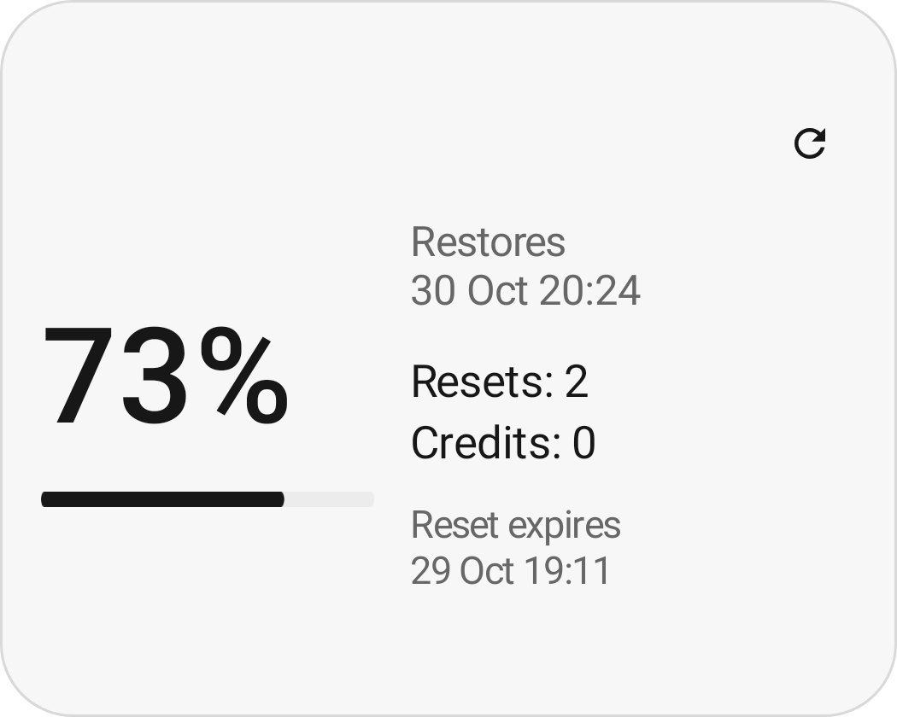
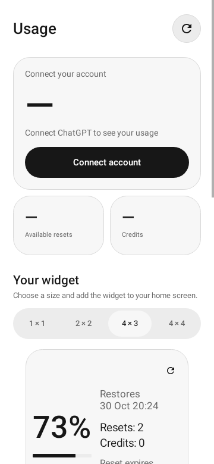

<div align="center">

# ChatGPT Usage

**Your plan limits, at a glance.**


[](LICENSE)

English · [Русский](README.ru.md)

[Download the latest release](https://github.com/crim50n/gpt-widget/releases/latest)

</div>

A small native Android app and home-screen widget for ChatGPT plan usage. Check your weekly allowance, reset dates and available resets without opening the website.

<div align="center">
  <picture>
    <source media="(prefers-color-scheme: dark)" srcset="app/src/main/res/drawable-night-nodpi/preview_overview.png">
    
  </picture>
  &nbsp;
  <picture>
    <source media="(prefers-color-scheme: dark)" srcset="docs/assets/settings-dark.png">
    
  </picture>
</div>

*Preview renders use demonstration data. English is the base language; Russian translation is included.*

## Features

- **Adaptive widgets:** 1×1, 2×2, 4×3 and 4×4 starting sizes, with layouts that change when resized.
- **Usage overview:** remaining weekly percentage, restoration time and prepaid credit balance.
- **Available resets:** count, expiration dates, and activation with confirmation.
- **Light, dark or system theme:** monochrome widgets, controls and dialogs.
- **Refresh your way:** manual updates or intervals from 15 minutes to 6 hours, with an animated loading indicator.
- **Date and time preferences:** 13 date formats and 12/24-hour clocks.
- **Translatable interface:** English and Russian, including widgets, errors, dialogs and launcher previews.
- **Device-code sign-in:** confirm a one-time code on OpenAI's page; token renewal is automatic.
- **Offline cache:** the last successful values remain visible when a request fails.

The usage pool covers Codex, Work, workspace agents and ChatGPT for Excel. Ordinary ChatGPT chat conversations are not included in that pool. Available windows depend on the account and plan.

## Install

Requires **Android 8.0 or later** and a browser for the initial authorization.

1. Download the signed `chatgpt-usage-<version>.apk` from this repository's **Releases** page.
2. Install and open **ChatGPT Usage**.
3. Select **Sign in**, get a code, and confirm it on the OpenAI sign-in page.
4. Return to the app. It verifies access to usage and resets before activating the session.
5. Choose a widget size and tap **Add widget**, or use your launcher's widget picker.

Android may delay background jobs during sleep or battery saving. Pulling data every 15 minutes does not guarantee an exact schedule. After force-stopping the app, open it again to resume work.

Early development builds used a debug signing key. If Android refuses to update such an installation with the signed release, remove the development build first and sign in again. Current debug builds use a separate `.debug` package.

## Authentication and privacy

The browser is used **only to confirm sign-in**. The app receives OAuth credentials and retrieves data directly through API requests: no WebView, HTML scraping, or browser-cookie extraction.

Credentials and pending login attempts are encrypted using Android Keystore. There is no analytics SDK or project-operated server. See [security and privacy](SECURITY.md) and [architecture](docs/ARCHITECTURE.md).

This is an independent project, not affiliated with OpenAI. It uses the Codex OAuth flow and internal ChatGPT endpoints, which may change without notice.

## Build

Use **JDK 17**, Android SDK **35**, and Build Tools **35.0.0**. Set `ANDROID_HOME` or create an ignored `local.properties` with `sdk.dir`.

```sh
./gradlew :app:assembleDebug :app:testDebugUnitTest :app:lintDebug
```

Debug APK: `app/build/outputs/apk/debug/app-debug.apk`.

- [Development and UI checks](docs/DEVELOPMENT.md)
- [Signed releases and GitHub Actions](docs/RELEASING.md)
- [Contributing](CONTRIBUTING.md)
- [Translating the app](docs/TRANSLATING.md)
- [Release notes](release-notes/1.0.0.md)

## License

[MIT](LICENSE). ChatGPT, Codex and OpenAI names belong to their respective owners.
