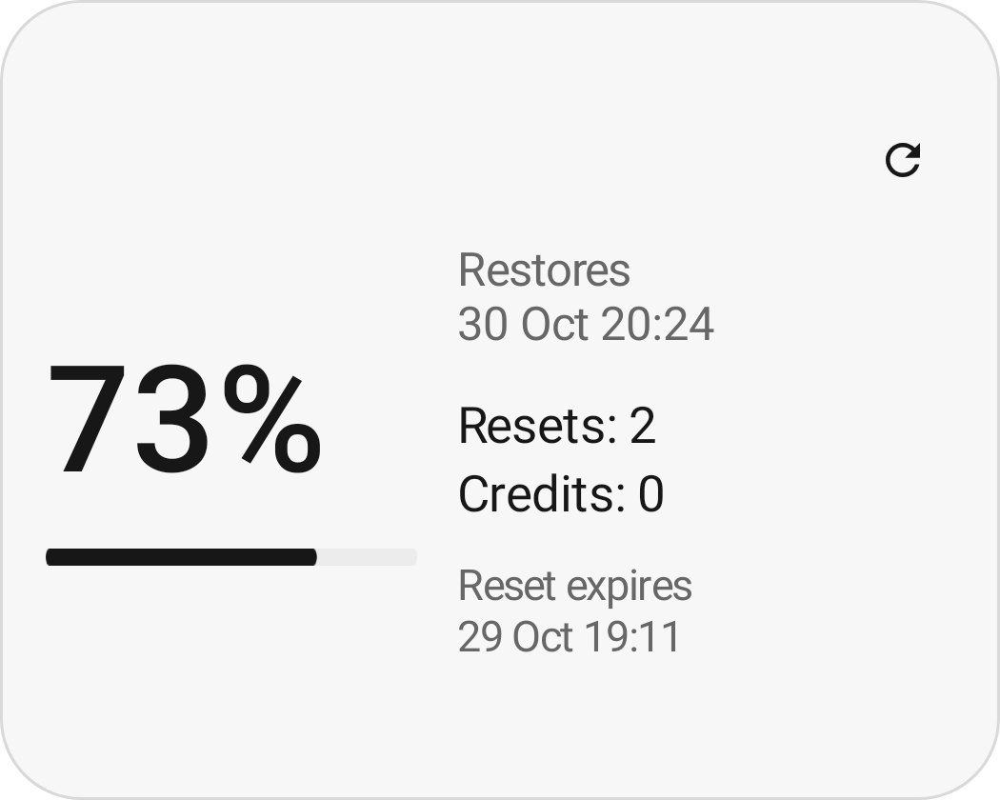
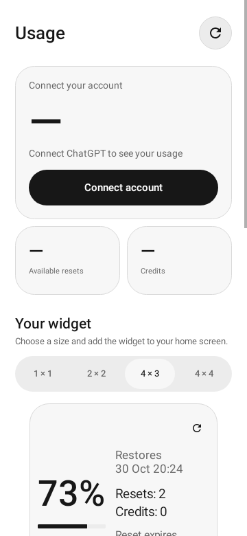

<div align="center">

# ChatGPT Usage

**Лимиты подписки — на главном экране.**


[](LICENSE)

[English](README.md) · Русский

[Скачать последнюю версию](https://github.com/crim50n/gpt-widget/releases/latest)

</div>

Небольшое нативное Android-приложение с виджетами для просмотра лимитов ChatGPT. Остаток недели, даты восстановления, кредиты и доступные сбросы — без открытия сайта.

<div align="center">
  <picture>
    <source media="(prefers-color-scheme: dark)" srcset="app/src/main/res/drawable-night-nodpi/preview_overview.png">
    
  </picture>
  &nbsp;
  <picture>
    <source media="(prefers-color-scheme: dark)" srcset="docs/assets/settings-dark.png">
    
  </picture>
</div>

*Изображения предпросмотра используют демонстрационные данные. Английский — базовый язык; русский перевод включён. Язык выбирается настройками Android.*

## Возможности

- **Адаптивные виджеты:** исходные размеры 1×1, 2×2, 4×3 и 4×4; при растягивании меняется компоновка.
- **Лимиты:** процент недельного остатка, время восстановления и баланс предоплаченных кредитов.
- **Сбросы:** количество, сроки истечения и применение с подтверждением.
- **Светлая, тёмная и системная темы** с единым монохромным оформлением.
- **Обновление вручную или по расписанию:** от 15 минут до 6 часов, с индикатором загрузки.
- **13 форматов даты**, 12- и 24-часовое время.
- **Поддержка перевода:** интерфейс, виджеты, ошибки и диалоги вынесены в языковые ресурсы.
- **Вход по одноразовому коду** и автоматическое продление OAuth-токена.
- **Кеш:** при ошибке сети остаётся последний успешный снимок данных.

Отображаемый пул относится к Codex, режиму «Работа», агентам рабочей области и ChatGPT для Excel. Обычные диалоги ChatGPT в этот пул не входят. Набор окон лимита зависит от аккаунта и тарифа.

## Установка

Нужны **Android 8.0+** и браузер для первоначального подтверждения входа.

1. Скачайте подписанный `chatgpt-usage-<версия>.apk` в разделе **Releases** этого репозитория.
2. Установите и откройте **ChatGPT Usage**.
3. Нажмите **Войти в аккаунт**, получите код и подтвердите его на странице авторизации OpenAI.
4. Вернитесь в приложение: оно проверит доступ к лимитам и списку сбросов, затем активирует сессию.
5. Выберите размер и нажмите **Добавить виджет** либо добавьте его через меню главного экрана.

Android может задерживать фоновые задания во сне и при экономии заряда. Интервал 15 минут — пожелание планировщику, а не точное расписание. После принудительной остановки откройте приложение снова.

Ранние экспериментальные APK подписывались debug-ключом. Если Android не разрешает обновить такую установку релизным APK, удалите экспериментальную версию и войдите заново. Текущие debug-сборки имеют отдельный пакет `.debug`.

## Авторизация и данные

Браузер нужен **только для подтверждения входа**. После этого приложение получает OAuth-токены и обращается к API напрямую. WebView, чтение HTML и извлечение cookies не используются.

Токены и незавершённые попытки входа зашифрованы с помощью Android Keystore. В приложении нет аналитики и собственного промежуточного сервера. Подробнее: [безопасность и приватность](SECURITY.md), [архитектура](docs/ARCHITECTURE.md).

Это независимый проект, не связанный с OpenAI. Используются OAuth-поток Codex и внутренние эндпоинты ChatGPT; изменения сервиса могут потребовать обновления приложения.

## Сборка

Требуются **JDK 17**, Android SDK **35** и Build Tools **35.0.0**. Укажите SDK через `ANDROID_HOME` или локальный `local.properties` с `sdk.dir`.

```sh
./gradlew :app:assembleDebug :app:testDebugUnitTest :app:lintDebug
```

Debug APK: `app/build/outputs/apk/debug/app-debug.apk`.

- [Разработка и проверка интерфейса](docs/DEVELOPMENT.md)
- [Релизная подпись и GitHub Actions](docs/RELEASING.md)
- [Участие в разработке](CONTRIBUTING.md)
- [Перевод приложения](docs/TRANSLATING.md)
- [Описание релиза](release-notes/1.0.0.md)

## Лицензия

[MIT](LICENSE). Названия ChatGPT, Codex и OpenAI принадлежат соответствующим правообладателям.
